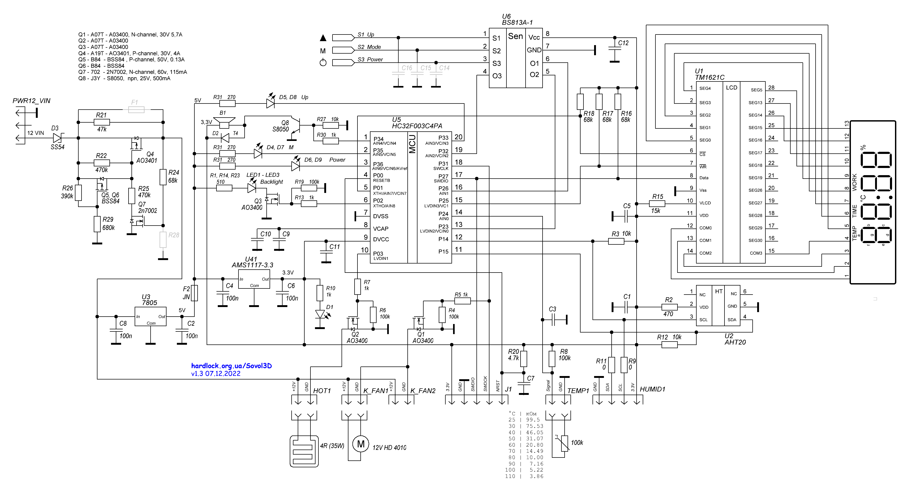

# Плата G24_V2.1 / HC32F005C6PA

| Ножка TSSOP20 | MCU | Назначение |
|---:|---|---|
| 1 | P34 | Звуковой выход, HIGH=ON |
| 2 | P35 | LED M, active LOW; альтернативный ISP TX |
| 3 | P36 | LED POWER, active LOW; альтернативный ISP RX |
| 4 | RESETB/P00 | NRST |
| 5 | P01 | TM1621C CS |
| 6 | P02 | Подсветка LCD, HIGH=ON |
| 7 | VSS | GND |
| 8 | VCAP | Конденсатор ядра |
| 9 | VDD | 3,3 V |
| 10 | P03 | Ключ нагревателя, HIGH=ON |
| 11 | P15 | I²C SDA |
| 12 | P14 | I²C SCL |
| 13 | P23 | Кнопка M, active LOW |
| 14 | P24/AIN0 | NTC пластины, ADC CH0 |
| 15 | P25 | TM1621C WR |
| 16 | P26 | Кнопка ▲, active LOW |
| 17 | P27/SWDIO | TM1621C DATA после старта; ROM ISP RX |
| 18 | P31/SWCLK | Ключ вентилятора после старта, HIGH=ON; ROM ISP TX |
| 19 | P32 | Кнопка POWER, active LOW |
| 20 | P33 | LED ▲, active LOW |

FT232 через штатную колодку: **3.3V → 3V3, GND → GND, TX → SWDIO,
RX → SWDCK, DTR → NRST**. Во время ISP штатные 12 V отключены.
На этой плате используется UART ROM-loader через P27/P31; это не SWD-протокол.
Вентилятор включается постоянно во время сушки, PWM пока не применяется.

Штатный датчик камеры по присланной схеме — AHT20, I²C `0x38`. Сначала
читается статус; при CAL=0 выполняется BE 08 00, затем AC 33 00 и шестибайтовый
ответ. Седьмой CRC-байт согласно руководству AHT20 необязателен; шестой байт
завершается NACK. Начиная с 1.2.0 AHT20 используется как аварийный резерв,
основной источник — дополнительный SHT4x. Если нет пригодных данных от обоих,
нагрев запрещён; перегрев по любому исправному цифровому датчику также запрещает нагрев.
SDA переводится во вход на ACK и при чтении. АЦП использует AVDD и девять
преобразований для среднего значения NTC. Независимые пороги среднего ADC ×10:
нагрев OFF ниже 1419, разрешение от 1860; отсечка камеры 73 °C.

## Дополнительный SHT4x в камере

Цифровые I²C SHT40/SHT41/SHT43/SHT45 подключаются параллельно AHT20 к HUMID1:

| HUMID1 / плата | Модуль SHT4x |
|---|---|
| 3,3 V | VDD / VCC |
| GND | GND |
| SDA / P15 | SDA |
| SCL / P14 | SCL |

Питание и сигналы 3,3 V; назначение контактов конкретного модуля следует брать
по его маркировке. Физический порядок HUMID1 на схеме: GND, SDA, SCL, 3,3 V.
Назначения SDA/SCL не меняются. Общая шина уже имеет подтяжки R3/R12 по 10 кОм.

Прошивка ищет SHT4x на `0x44`, `0x45`, `0x46`. После адресного soft reset `0x94`
проверяется serial `0x89` с двумя CRC; измерение — `0xFD`, чтение через 10 мс,
оба слова проверяются CRC-8 (`0x31`, начальное `0xFF`). Адресный reset не сбрасывает
AHT20. Встроенный нагреватель самого SHT4x не включается.

Ошибка чтения или CRC сразу делает текущий результат SHT4x непригодным.
После трёх последовательных ошибок повторяется поиск адреса. Оба датчика имеют
независимые сроки опроса; ожидание измерения не блокирует кнопки и таймер.
Управление и LCD используют один выбранный источник, контроль 73 °C проверяет
каждый исправный свежий источник отдельно; данные старше 3 секунд не используются.
Протокол сверяется с [документацией Sensirion](https://sensirion.com/resource/datasheet/sht4x).

## Сверка схемы, присланной владельцем

Источник: [hardlock.org.ua/Sovol3D](https://hardlock.org.ua/Sovol3D/),
схема v1.3 от 07.12.2022, изображение предоставлено владельцем.
На схеме U5 подписан HC32F003C4PA; фактический целевой MCU проекта — HC32F005C6PA.
Схема используется для соединений, а не для смены типа MCU в сборке/программаторе.

- Кнопки сенсорные: BS813A-1, выходы O1 → P26/▲, O2 → P23/M, O3 → P32/POWER;
  внешние подтяжки 68 кОм. Устойчивое активное состояние — LOW.
- LED ▲/M/POWER подключены к P33/P35/P36 через резисторы от 5 V, управление LOW.
- Датчик AHT20 питается от 3,3 V через R2 470 Ом; SCL=P14, SDA=P15,
  внешние подтяжки R3/R12 по 10 кОм. HUMID1: GND, SDA, SCL, 3,3 V.
- TEMP1: NTC 100 кОм, подтяжка R8 100 кОм к 3,3 V, вход P24/ADC0.
- Ключи нагревателя Q2 и вентилятора Q1 — AO3400, управление P03/P31 через 1 кОм.
- LCD CS=P01, WR=P25, DATA=P27; подсветка P02 через Q3.

Эти назначения совпадают с текущей таблицей. Перестановка SDA/SCL не требуется.

